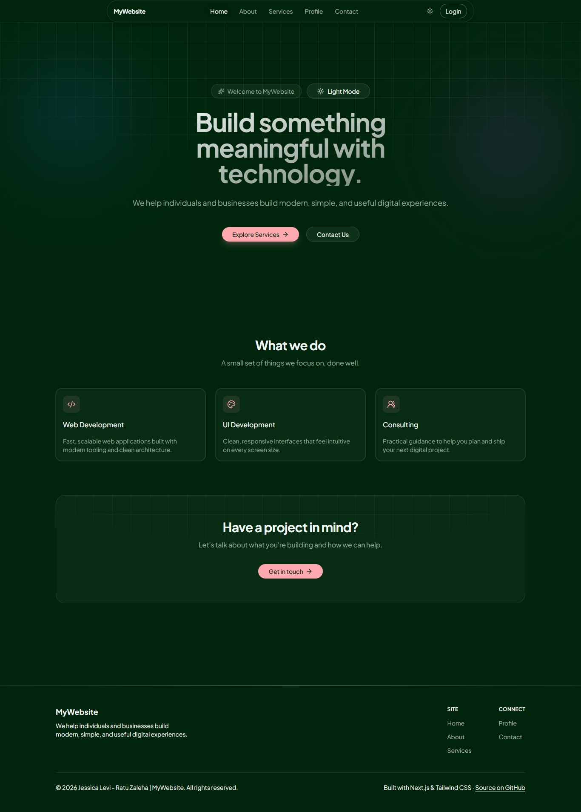
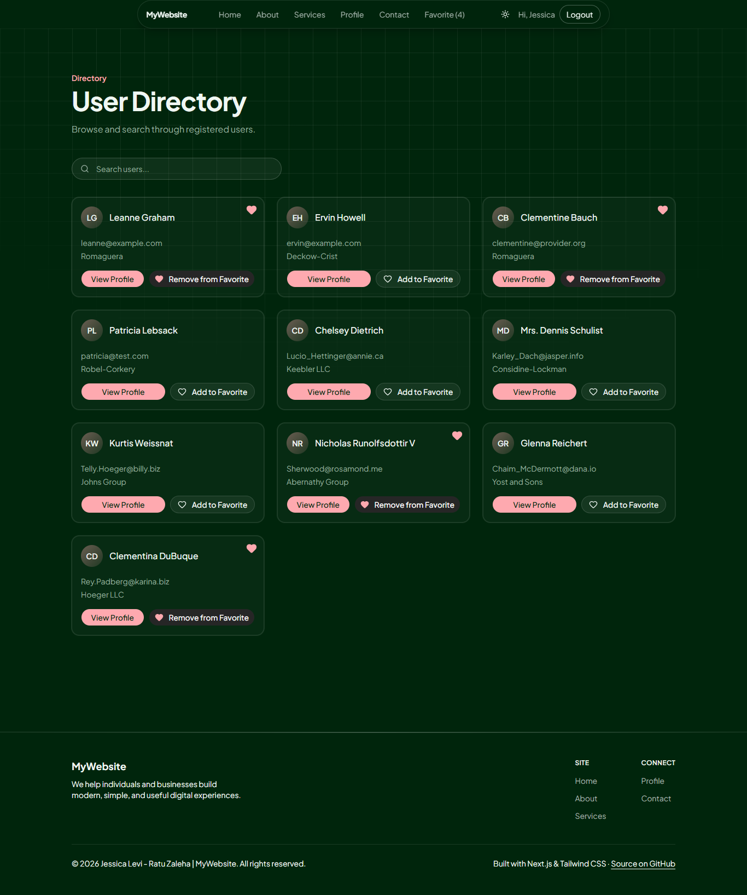
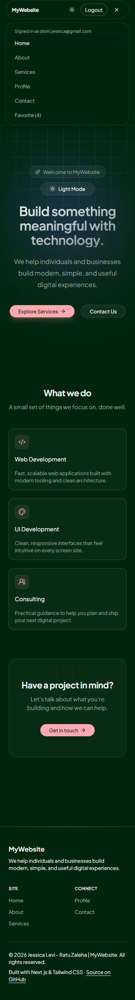
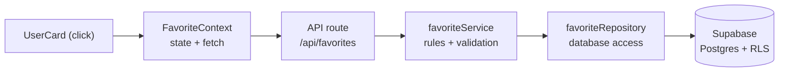

# MyWebsite — Next.js Company Profile

A responsive company-profile website built with the **Next.js App Router**, featuring real authentication, a database-backed **per-account favorites** feature, and an admin-only message inbox. Built as a learning project during Bootcamp Perempuan Inovasi 2026.

**Live demo:** https://belajar-nextjs-companyprofile.vercel.app





## Features

- **Public pages** — Home, About, Services, Profile and Contact, with per-page titles and a custom 404 page.
- **Authentication** — sign up, log in and log out with Supabase Auth. Sessions live in cookies and are refreshed on every request in `proxy.js`.
- **User directory** — a searchable list of users read from the `app_users` table in Postgres.
- **Favorites per account** — add and remove favorites that are stored in the database with `favorited_by` set to the logged-in account. Buttons show a pending state, double clicks are ignored, and server errors appear on the card.
- **Contact form and inbox** — messages are saved to Supabase. Only the site owner can read or delete them at `/messages`.
- **Theme and responsive UI** — dark/light toggle, a mobile menu, and a greeting for the signed-in user.
- **Maintenance mode** — set `MAINTENANCE_MODE=true` to redirect every page to `/maintenance`.

## Tech stack

| Area      | Tools                                                                 |
| --------- | --------------------------------------------------------------------- |
| Framework | Next.js 16 (App Router), React 19                                     |
| Styling   | Tailwind CSS 4, shadcn/ui (Base UI), lucide-react, next-themes        |
| Backend   | Supabase: Auth and Postgres with Row Level Security (`@supabase/ssr`) |
| Testing   | Jest 30                                                               |
| Hosting   | Vercel                                                                |

## Architecture

Every feature follows the same layers, so each one has a single job and can be tested on its own. This is the flow when a user clicks **Add to Favorite**:



| Layer      | File                                     | Responsibility                                             |
| ---------- | ---------------------------------------- | ---------------------------------------------------------- |
| UI state   | `context/FavoriteContext.jsx`            | Holds favorites, prevents double clicks, shows errors      |
| API route  | `app/api/favorites/route.js`             | Checks the user is logged in (401 otherwise), returns JSON |
| Service    | `lib/services/favoriteService.js`        | Business rules: validation, no duplicates, 404 on missing  |
| Repository | `lib/repositories/favoriteRepository.js` | The only place that talks to Supabase                      |
| Database   | Supabase                                 | Tables and Row Level Security policies                     |

Login follows a similar path: the form calls a server action in `app/login/actions.js`, Supabase stores the session in a cookie, `proxy.js` refreshes it on each request, and `app/layout.js` passes the user to `AuthProvider` so any component can call `useAuth()`.

## Security

- The Supabase anon key is public by design, so access is enforced with **Row Level Security** in the database, not only in application code.
- **Favorites** — policies let an account select, insert and delete only rows where `favorited_by` equals its own id. The column defaults to `auth.uid()`, and the service only forwards `user_id`, so the client cannot choose who a favorite belongs to.
- **Messages** — anyone can insert, but only the owner's email can read or delete. The `/messages` page and its delete action both re-check `isAdmin()` on the server.
- API routes return `401` when logged out, validate their input, and send a generic message to the client while logging details on the server.
- `proxy.js` redirects visitors who are not logged in from `/favorites` and `/messages` to `/login`. This is a convenience; the server checks and database policies are the real protection.

## Getting started

**Prerequisites:** Node.js 20 or newer and a free [Supabase](https://supabase.com) project.

```bash
git clone https://github.com/JessicaLevi/belajar-nextjs-companyprofile.git
cd belajar-nextjs-companyprofile
npm install
cp .env.example .env.local   # then fill in your values
npm run dev
```

Open http://localhost:3000.

### Environment variables

| Variable                        | Required        | Purpose                                                                          |
| ------------------------------- | --------------- | -------------------------------------------------------------------------------- |
| `NEXT_PUBLIC_SUPABASE_URL`      | Yes             | Your Supabase project URL                                                        |
| `NEXT_PUBLIC_SUPABASE_ANON_KEY` | Yes             | Your Supabase anon (public) key                                                  |
| `ADMIN_EMAIL`                   | For `/messages` | Email of the account allowed to manage messages. If it is empty, nobody is admin |
| `MAINTENANCE_MODE`              | No              | Set to `true` to show the maintenance page                                       |

### Database setup

Create these tables in the Supabase SQL editor or table editor:

- `app_users` — `id` (int8, primary key), `name`, `email`, `company_name`. Insert a few rows to populate the directory.
- `favorites` — `id` (int8, primary key), `created_at` (timestamptz), `user_id` (int8, references `app_users.id`), `favorited_by` (uuid, references `auth.users.id`).
- `messages` — `id`, `name`, `email`, `message`, `created_at`.

Then add the policies:

<details>
<summary>Row Level Security policies (SQL)</summary>

```sql
-- favorites: defaults and uniqueness
alter table favorites
  alter column favorited_by set default auth.uid();
alter table favorites
  add constraint favorites_favorited_by_user_id_key unique (favorited_by, user_id);

-- favorites: each account only sees and changes its own rows
alter table favorites enable row level security;

create policy "favorites_select_own" on favorites
  for select to authenticated using (favorited_by = (select auth.uid()));
create policy "favorites_insert_own" on favorites
  for insert to authenticated with check (favorited_by = (select auth.uid()));
create policy "favorites_delete_own" on favorites
  for delete to authenticated using (favorited_by = (select auth.uid()));

-- app_users: public read-only
alter table app_users enable row level security;
create policy "app_users_read" on app_users
  for select to anon, authenticated using (true);

-- messages: anyone can send, only the owner can read or delete
alter table messages enable row level security;
create policy "messages_insert_anyone" on messages
  for insert to anon, authenticated with check (true);
create policy "messages_admin_select" on messages
  for select to authenticated using ((auth.jwt() ->> 'email') = 'YOUR_ADMIN_EMAIL');
create policy "messages_admin_delete" on messages
  for delete to authenticated using ((auth.jwt() ->> 'email') = 'YOUR_ADMIN_EMAIL');
```

</details>

## Scripts

| Command         | What it does                 |
| --------------- | ---------------------------- |
| `npm run dev`   | Start the development server |
| `npm run build` | Create a production build    |
| `npm start`     | Run the production build     |
| `npm run lint`  | Lint the code with ESLint    |
| `npm test`      | Run the unit tests with Jest |

The tests cover `favoriteService` with a mocked repository, so they run without a database.

## Project structure

```
app/                    Pages and route handlers (folder name = URL)
  api/favorites/        GET and POST /api/favorites, DELETE /api/favorites/:id
  api/users/            GET /api/users
  auth/signout/         POST sign-out
  login/ contact/ messages/ favorites/ users/ ...
components/             Navbar, Footer, UserCard and ui/ (shadcn)
context/                AuthContext, FavoriteContext, UserContext
lib/
  supabase/             Server, browser and session-refresh clients
  repositories/         Database access only
  services/             Business rules (tests in __test__/)
  validations/          Input checks
  auth.js               isAdmin()
proxy.js                Maintenance mode, session refresh, protected routes
```

## Possible next steps

- Fetch the user directory in a Server Component instead of the client.
- Add tests for the API routes and the validation helpers.
- Run `npm test` and `npm run lint` in a GitHub Actions workflow.

## Author

**Jessica Levi** — [@JessicaLevi](https://github.com/JessicaLevi)
